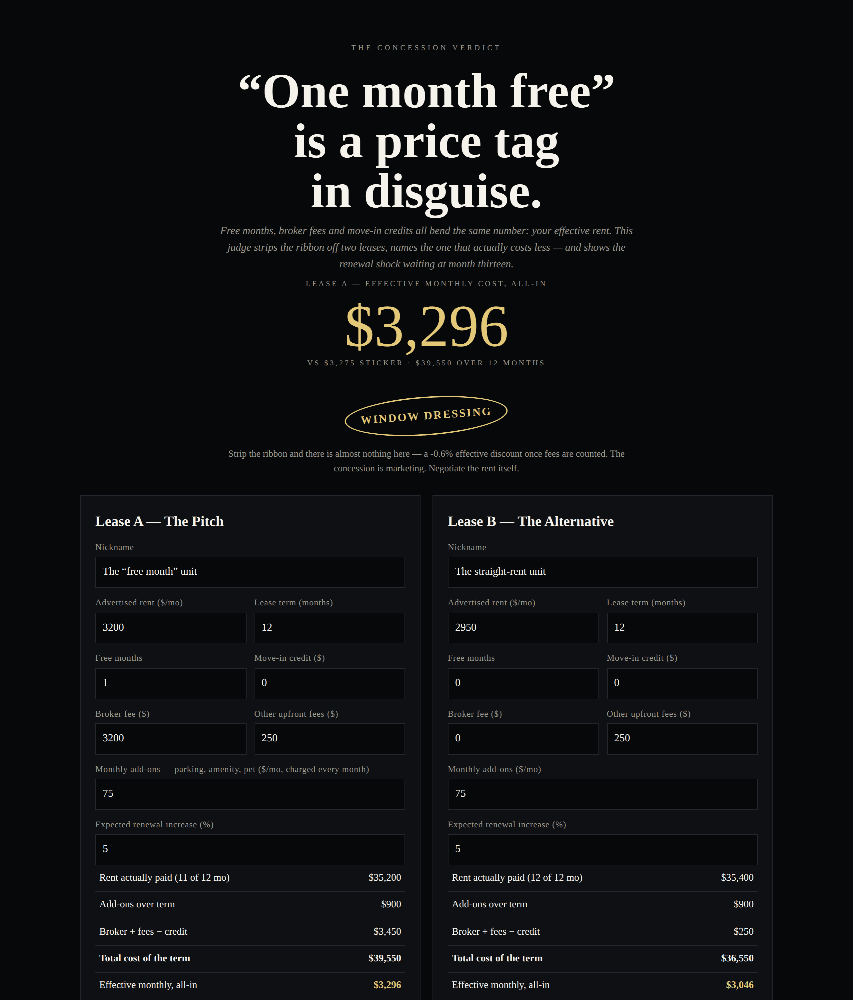

# The Concession Verdict

**Live:** https://thebullbrew.github.io/concession-verdict/

## What it does

"One month free" is a price tag in disguise. This judge strips the ribbon off two leases at once — free months, move-in credits, broker fees, upfront fees and monthly add-ons — and reduces each to the only number that matters: the effective monthly cost, all-in, over the term. It names the honest winner between Lease A and Lease B, translates the concession into the equivalent straight rent cut (the version that renews with you), and exposes the renewal shock: landlords renew off the inflated face rent, not your effective rent, so the jump at month thirteen is always bigger than the "increase" sounds. Verdict seals: REAL DEAL, FAIR TRADE, WINDOW DRESSING, RENEWAL TRAP. Includes a 0–10% renewal-increase sensitivity table, saveable comparisons (localStorage), and a copyable summary.

## The method

- Effective rent = (rent actually paid + add-ons over the term + broker fee + other fees − credits) ÷ term. Add-ons are charged in free months, as most leases do.
- True discount = effective all-in vs the sticker monthly (face + add-ons).
- Renewal shock = renewal rent (face × (1 + increase)) vs your effective rent — the gap nobody shows you at signing.
- A free month dies at renewal; a rent cut compounds. The tool prices both so you can ask for the right one.

For renters comparing listings, and for landlords and agents who want to know what their concession actually costs.

## How to run

Open `docs/index.html` in any browser, or visit the live link above. Static, offline-capable PWA — no backend, no accounts, your numbers never leave your device.
